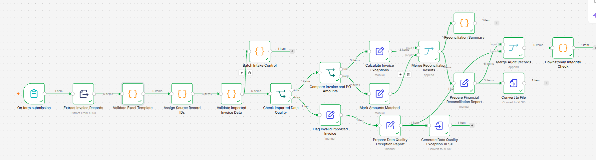
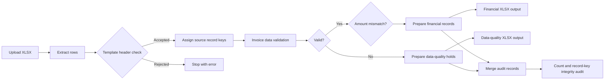
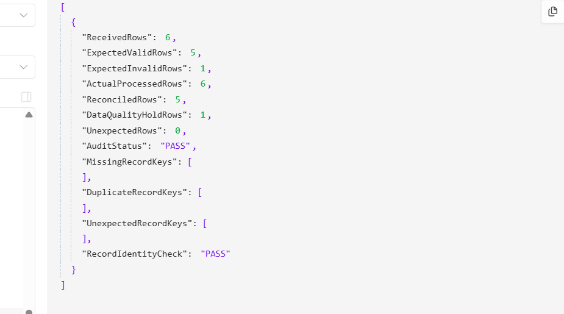
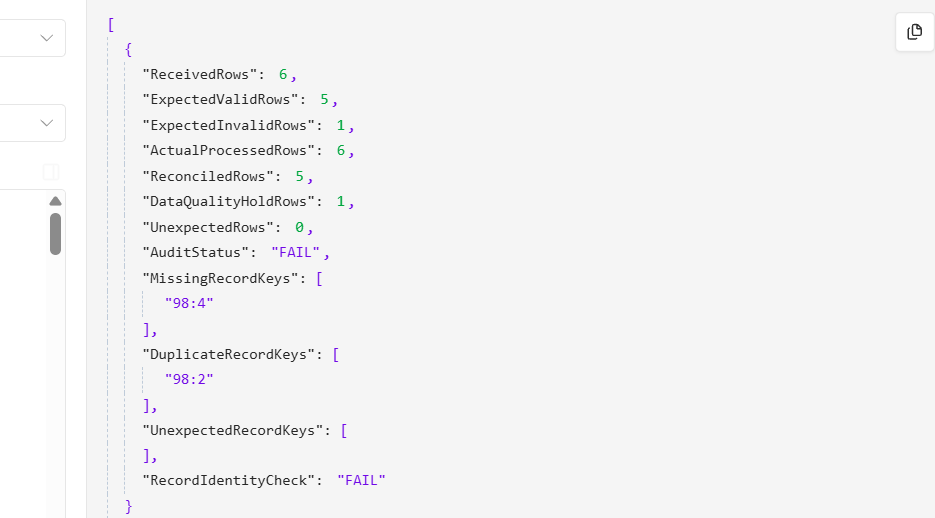

# Automated AP Invoice Reconciliation & Exception Management

**A hands-on n8n + JavaScript + Excel portfolio project** demonstrating rule-based invoice validation, purchase-order amount comparisons, exception reporting, and record-level integrity controls.

> **Scope:** This is a tested **portfolio demonstration**, not a deployed or production-certified accounts payable system. All sample invoices are synthetic. Purchase-order amounts are provided in the **same uploaded spreadsheet**; the workflow does **not** look up or independently verify a purchase order in an ERP system.

## Business problem

Invoice spreadsheets can contain missing supplier details, differing invoice and PO amounts, duplicate invoice identifiers, and malformed column names. Manual reviews can miss exceptions or lose track of records as they move between reports.

This workflow imports an XLSX file and separates cleanly structured invoices into financial reconciliation results and data-quality holds. It calculates a financial summary and independently checks whether source records appear once in the downstream report-preparation data.

## What it does

- Receives a single `.xlsx` upload through an n8n form and extracts worksheet data.
- Recognizes specific header typos (for example `PO_Amount` in place of `POAmount`) and rejects the upload with a helpful error.
- Tags each extracted record with an execution-specific `SourceRecordKey`.
- Validates invoice ID, vendor, numeric financial values, and duplicate `(Vendor, InvoiceID)` pairs.
- Compares `InvoiceAmount` against `POAmount` and calculates signed differences for valid records.
- Calculates reconciliation totals, mismatch counts, exception rate, and absolute discrepancy magnitude.
- Produces two downloadable XLSX **binary outputs inside n8n**: financial reconciliation details and data-quality exceptions.
- Checks downstream record counts and source keys for missing, duplicate, or unexpected records.

## Reference test: mixed batch

The six-row synthetic batch in [`sample_inputs/01_mixed_batch.xlsx`](sample_inputs/01_mixed_batch.xlsx) produced the following verified results:

| Metric | Result |
| --- | ---: |
| Uploaded invoice records | 6 |
| Data-quality valid / invalid | 5 / 1 |
| Amount mismatches / amount matches among valid records | 3 / 2 |
| Invoice amount total (valid records only) | 7,550 |
| PO amount total (valid records only) | 7,200 |
| Net signed difference | +350 |
| Sum of absolute differences | 650 |
| Mismatch rate among valid records | 60% |
| Downstream count audit | PASS |
| Record-identity audit | PASS |

The example currency values are test amounts; no live financial data is used.

## Architecture

A separate summary branch calculates metrics for valid invoices. **Important:** the XLSX conversion branches currently execute independently of the final audit, so an audit failure does **not** automatically prevent file generation or delivery.

## Try it locally

1. Set up a recent, compatible n8n instance with the standard Form Trigger, Extract From File, Code, IF, Edit Fields, Merge, and Convert to File nodes.
2. In the n8n editor, use **Import from File** (wording varies by version) and choose [`workflow/n8n_ap_invoice_reconciliation_v1.json`](workflow/n8n_ap_invoice_reconciliation_v1.json).
3. Review the imported settings; test that the form trigger accepts `.xlsx` files. The workflow is exported **inactive** and requires local configuration and testing before publishing.
4. Start a test execution and submit [`sample_inputs/01_mixed_batch.xlsx`](sample_inputs/01_mixed_batch.xlsx).
5. Inspect `Reconciliation Summary`, `Downstream Integrity Check`, and the two `Convert to XLSX` outputs. Download their binary files from the n8n execution editor if desired.
6. Try `02_all_valid.xlsx`, `03_all_invalid.xlsx`, and `04_bad_header.xlsx` to exercise the edge cases.

**Do not upload real customer, supplier, or invoice records to a publicly accessible demo form.** An n8n form may require access restrictions before real-world deployment.

## Evidence and testing

The screenshots below show results from the original local test workflow, before regeneration of identifiers in this public copy:

| Successful audit | Simulated duplicate with an absent key |
| --- | --- |
|  |  |

The failure screenshot demonstrates an intentionally injected duplicate source key; the original Code node was restored after the test. See [`docs/TEST_PLAN.md`](docs/TEST_PLAN.md) for the tested scenarios and outcomes.

## Project contents

- [`workflow/`](workflow/) — sanitized workflow JSON (19 nodes, original workflow logic retained)
- [`sample_inputs/`](sample_inputs/) — four synthetic Excel test cases
- [`docs/TEST_PLAN.md`](docs/TEST_PLAN.md) — verification cases, expected results, and observed evidence
- [`docs/ARCHITECTURE.md`](docs/ARCHITECTURE.md) — controls and data flow
- [`docs/DEMO_SCRIPT.md`](docs/DEMO_SCRIPT.md) — walkthrough for hiring managers and portfolio review
- [`docs/SECURITY_AND_LIMITATIONS.md`](docs/SECURITY_AND_LIMITATIONS.md) — controls, limitations and privacy notes

## Technology

n8n • JavaScript • Microsoft Excel (`.xlsx`) • Rule-based data-quality validation • Reconciliation controls • Batch-level and source-record integrity checks

## Status

**Version 1.0 — portfolio demonstration.** Representative positive, negative, all-valid, all-invalid, and incorrect-template scenarios have been manually tested. No automated test suite, independent ERP integration, automatic email delivery, or production release gate is claimed.
